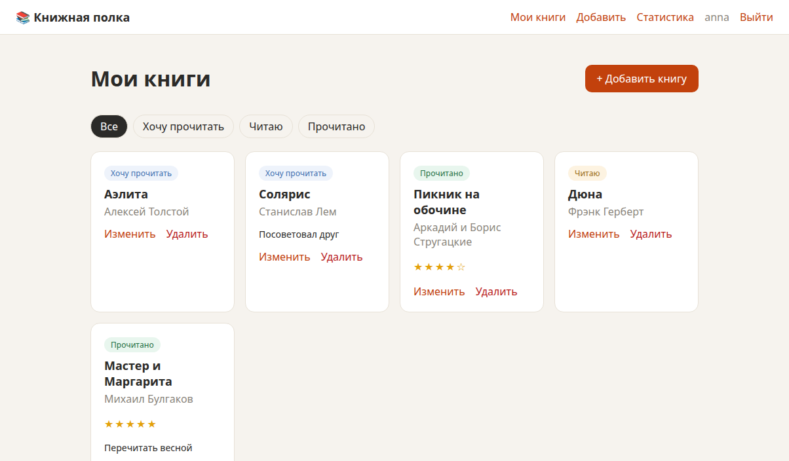

# Книжная полка

Финальный проект курса [Практический курс по Flask](https://stepik.org/course/302580) на Stepik. Это читательский дневник на Flask, который студенты собирают шаг за шагом в 10-м модуле курса.



## Что умеет приложение

- регистрация и вход, пароли хранятся только в виде хеша;
- у каждого пользователя своя полка, где можно добавить, изменить и удалить книгу;
- статусы "Хочу прочитать", "Читаю", "Прочитано" и фильтр по ним;
- оценка от 1 до 5 и заметка к книге;
- страница статистики;
- JSON API для своих книг;
- свои страницы ошибок 403 и 404;
- 30 автоматических тестов на pytest.

Бэкенд написан вручную. HTML-шаблоны и CSS сгенерированы ИИ по техническому заданию из файла [PROMPT.md](PROMPT.md).

## Как запустить

Нужен Python 3.9 или новее. Команды выполняются из корня репозитория.

```bash
git clone https://github.com/levinadev/flask_practical_course_bookshelf.git
cd flask_practical_course_bookshelf
python3 -m venv .venv   # Windows: python -m venv .venv
source .venv/bin/activate   # Windows: .venv\Scripts\activate
pip install -e ".[test]"
flask --app bookshelf init-db
flask --app bookshelf run --debug
```

Откройте в браузере адрес `http://127.0.0.1:5000`, зарегистрируйтесь и добавьте первую книгу. Сервер останавливается клавишами `Ctrl+C`.

Тесты запускаются одной командой.

```bash
pytest
```

## Как устроен проект

```text
bookshelf/              пакет приложения
├── __init__.py         фабрика create_app
├── db.py               работа с базой SQLite
├── schema.sql          таблицы базы данных
├── auth.py             blueprint с регистрацией, входом и выходом
├── books.py            blueprint с книгами и статистикой
├── api.py              blueprint с JSON API
├── templates/          шаблоны страниц
└── static/style.css    стили
tests/                  тесты pytest
PROMPT.md               техническое задание для ИИ на фронтенд
pyproject.toml          описание проекта и зависимостей
```

База данных создаётся в папке `instance/`. Эта папка в репозиторий не попадает.

## Перед публикацией в интернете

В проекте стоит учебный секретный ключ `dev`. Для рабочего сервера создайте файл `instance/config.py` с настоящим ключом, запускайте приложение производственным WSGI-сервером (например, `waitress-serve --call 'bookshelf:create_app'`) и не включайте режим отладки.

## Лицензия

[MIT](LICENSE)
